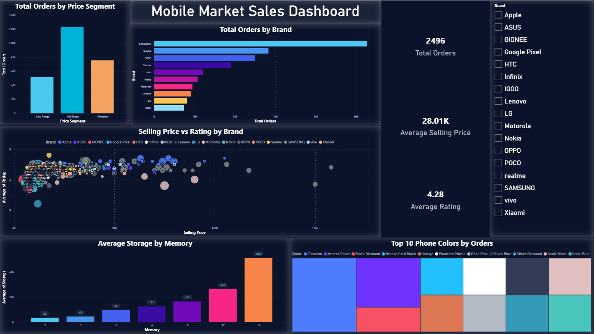
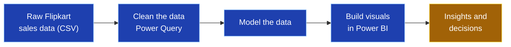
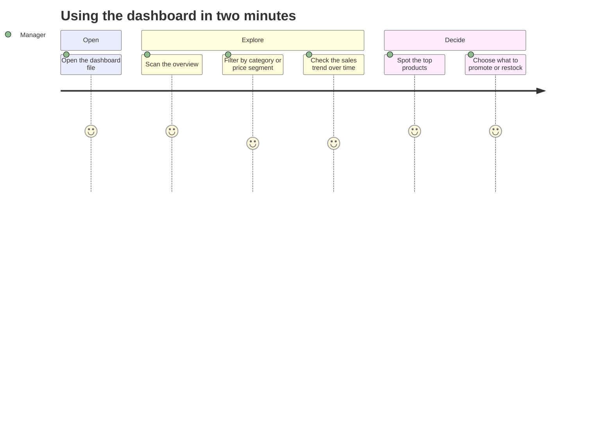

<p align="center">
  
</p>

<p align="center">
  
</p>

<p align="center">
  
  
  
</p>

<p align="center">
  
  
</p>

<p align="center">
  <a href="#-the-big-picture">Big Picture</a> •
  <a href="#-dashboard-preview">Preview</a> •
  <a href="#-questions-it-answers">Questions</a> •
  <a href="#-how-it-was-built">How It Was Built</a> •
  <a href="#-how-to-use">How to Use</a> •
  <a href="#-next-steps">Next Steps</a>
</p>

---

##  The Big Picture

> [!NOTE]
> **In one sentence:** this project takes raw Flipkart sales data and turns it into **one interactive Power BI dashboard** that shows what sells, at what price, and when.

**Explain it like I'm five:**
A car dashboard lets you see speed, fuel and warnings in one glance, without opening the engine. A sales dashboard does the same for a business. Instead of scrolling through thousands of spreadsheet rows, you look at one page and instantly see what is going well and what needs attention.

|  Car dashboard |  Sales dashboard |
|---|---|
| Speedometer | Total sales and trends over time |
| Fuel gauge | Which categories and products are "running low" or "full speed" |
| Warning lights | Weak segments that need attention |

```
 Thousands of raw sales rows   ➜    Clean and model   ➜    Interactive dashboard   ➜   Decisions in seconds
```

---

##  Dashboard Preview

<p align="center">
  
</p>

> [!TIP]
> Want to explore it hands-on? Open `Flipkart_Dashboard.pbix` in Power BI Desktop (see [How to Use](#-how-to-use)) and click around: every chart is filterable.

---

##  Questions It Answers

Every good dashboard starts with a question. This one answers five:

| | The business asks... | The dashboard shows |
|:-:|---|---|
|  | *"Which price range sells the most?"* | **Sales distribution by price segment**: total sales across different price ranges |
|  | *"Which product categories perform best?"* | **Product category performance**: revenue and volume compared across categories |
|  | *"Are sales going up or down?"* | **Sales trends over time**: how sales evolve across time periods |
|  | *"How do customers like to buy?"* | **Customer purchasing patterns**: recurring behaviors in how people shop |
|  | *"Which products are our stars?"* | **High-performing products**: the top products driving the most sales |

###  Who can use it?

| Role | What they would look at first |
|---|---|
|  **Store owner** | High-performing products and sales trends |
|  **Marketing manager** | Price segments and customer purchasing patterns |
|  **Inventory planner** | Category performance and trends over time |
|  **Data student** | The full pipeline: cleaning, modeling, visualizing |

---

##  How It Was Built



<details>
<summary><b> The three stages in plain words (click to expand)</b></summary>

<br/>

1. ** Cleaned:** raw sales records usually contain mess (gaps, inconsistencies). These were tidied up so the numbers can be trusted.
2. ** Modeled:** the cleaned data was organized so Power BI can slice it by price, category, time and more.
3. ** Visualized:** charts were designed to turn those numbers into patterns a person can read at a glance.

</details>

### 🕑 A manager's 2-minute tour



---

##  Tools Used

| Category | Tools |
|---|---|
|  Visualization & Reporting | Power BI |
| 🧹 Data Preparation | Data Cleaning (Power Query) |
| 📄 Data Source | Flipkart Sales Dataset (CSV) |

---

## 📁 Project Structure

```
Flipkart-Sales-Dashboard/
│
├── images/
│   └── Dashboard.png          # Dashboard preview
├── Flipkart_Dashboard.pbix    # Power BI dashboard file
└── README.md
```

---

## 🚀 How to Use

1. **Get the files**
   ```bash
   git clone https://github.com/khaled-amireh/Flipkart-Sales-Dashboard.git
   ```
2. **Open** `Flipkart_Dashboard.pbix` in [Power BI Desktop](https://www.microsoft.com/en-us/power-platform/products/power-bi/downloads).
3. **Explore:** use the filters and slicers to drill into specific categories, price segments or time periods. Clicking one chart usually filters the others too.

> [!NOTE]
> Power BI Desktop runs on **Windows**. If you can't open the `.pbix` file, the preview image above shows the full dashboard.

---

## 🎯 Project Goal

The goal of this project is to practice **end-to-end data analysis and visualization** with real-world sales data: from cleaning raw records to designing a dashboard that communicates insights clearly and supports data-driven decisions.

| Skill practiced | Where it shows up |
|---|---|
| 🧹 Data cleaning | Preparing the raw sales data |
| 🧱 Data modeling | Organizing data for slicing and filtering |
| 📊 Visualization | Charts built around the five key questions |
| 🗣️ Data storytelling | One page that explains the business at a glance |

---

## 🔭 Next Steps

- [ ] Add more screenshots, one per dashboard page
- [ ] Document the key DAX measures behind the visuals
- [ ] Add a short data dictionary explaining each column
- [ ] Record a short GIF of the filters in action

---

## 👤 Author

<p align="center">
  <b>Khaled Amireh</b><br/>
  <a href="https://github.com/khaled-amireh">🔗 GitHub</a>
</p>

<p align="center"><i>If this project helped you, drop a ⭐ on the repo.</i></p>

<p align="center">
  
</p>
